# A blueprint, step by step

This guide follows one real blueprint, one short chapter per step: a family
asks the architect for a small recipe web app. Every picture comes from that
run. To look something up, such as every reply you can type, see the
[reference](reference.md).

1. [What the architect is](#1-what-the-architect-is)
2. [Before you start](#2-before-you-start)
3. [Starting a blueprint](#3-starting-a-blueprint)
4. [Saying what you need](#4-saying-what-you-need)
5. [The interview](#5-the-interview)
6. [Trying the screen](#6-trying-the-screen)
7. [Cutting the work into slices](#7-cutting-the-work-into-slices)
8. [What every slice shares](#8-what-every-slice-shares)
9. [Designing each slice](#9-designing-each-slice)
10. [Checking against the code](#10-checking-against-the-code)
11. [What done means](#11-what-done-means)
12. [Writing the cards](#12-writing-the-cards)
13. [Readiness](#13-readiness)
14. [Sign-off](#14-sign-off)
15. [Cards on the board](#15-cards-on-the-board)
16. [When it is finished](#16-when-it-is-finished)
17. [Learning from cards that struggled](#17-learning-from-cards-that-struggled)
18. [Reading the sheet](#18-reading-the-sheet)

## 1. What the architect is

The architect turns something you want built into a plan, and the plan into
cards an AI agent can build.

**ContextMatrix** is a task board. Each piece of work on it is a **card**, and
an AI agent builds what a card describes in your project's code. A card the
agent can finish on its first try takes care to write: what to build, where in
the code, and how to check that it works. The architect does that work with
you. You say what you need in your own words; it interviews you, works the plan
out step by step and writes the cards, and you approve each big decision before
the next step builds on it.

On the way it plays the roles a team would: a product owner who works out the
need, a designer, a system designer, a senior developer and a tester. Each
step's work is checked, by an AI reviewer or by the architect's own rules, and
every decision is recorded with what it rests on. At the end the cards go
on the board as a **playbook**, the cards in the order they are built, or as a
single card when the need is that small.

One need worked out this way, from your first message to cards on the board, is
a **blueprint**. Each blueprint is one chat in ContextMatrix.

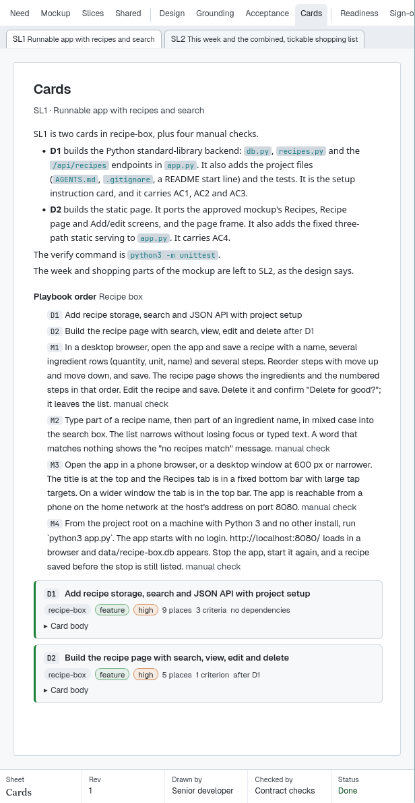

This sheet is from near the end of the example: the cards for the first part of
the recipe app, written and checked, before they go on the board.

## 2. Before you start

This step makes sure the architect is there when you open ContextMatrix.

You need ContextMatrix with the architect installed and connected to it, and an
AI model as capable as Anthropic's Claude Sonnet. If **Blueprint** is not
offered when you start a new chat (chapter 3), the architect is not set up yet.
[Installing the architect](installing.md) says what you need and how to get it
running.

## 3. Starting a blueprint

This step creates the blueprint and sets how it runs.

In ContextMatrix's sidebar, click **+ new** beside **Chat**, then choose
**Blueprint**. The dialog's title changes to **New blueprint**:

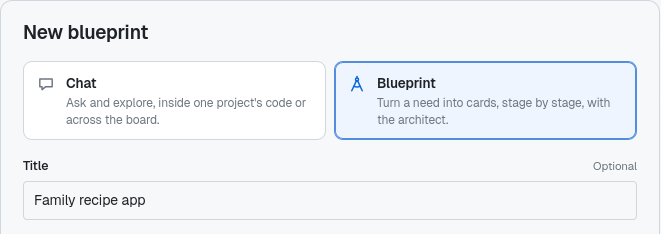

Below the title comes **Projects**, a list of your ContextMatrix projects, each
with a tick box and the name of its code repository. The family ticked
recipe-box. The rest of the dialog:

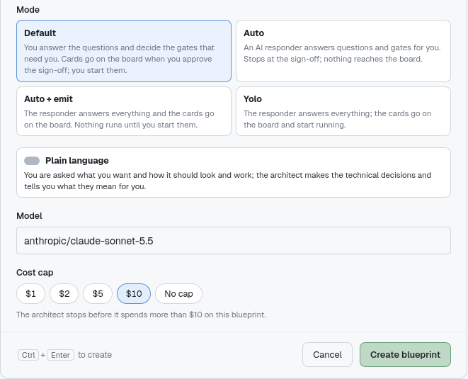

| Field | What it sets | In the example |
|---|---|---|
| Title | A name for the blueprint. Left blank, it is named from your first message. | Family recipe app |
| Projects | The ContextMatrix projects the work goes into. Tick at least one. | recipe-box, a new project whose repository holds only a short description file |
| Mode | How much the architect does without you. In **Default** you answer its questions and decide the **gates** that need you, the stops where a step's result is approved. In **Auto**, **Auto + emit** and **Yolo** an AI answers for you. See [Modes](reference.md#modes). | Default |
| Plain language | Asks you only what you want and how it should look and work; the architect makes the technical decisions and tells you what they mean for you. Set here, and kept. See [Plain language](reference.md#plain-language). | Off |
| Model | The AI model the architect uses: one as capable as Claude Sonnet. See [Models](reference.md#models). | A Claude Sonnet model |
| Cost cap | The most the architect may spend on this blueprint, in US dollars: $1, $2, $5, $10 or No cap. See [The cost cap](reference.md#the-cost-cap). | $10 |

Click **Create blueprint**, or press Ctrl+Enter. You can change the cap at any
time, and switch the mode until you approve the **sign-off**, the last approval
before the cards go on the board; both are on the scale bar (chapter 4).

recipe-box is marked as a proof of concept (**POC**) in ContextMatrix, so its
cards ask for tests of the main behaviour and less hardening (fewer extra guards
against unusual cases); the design work is the same. See [POC projects](reference.md#poc-projects).

**Research**, which lets the architect search the web before it asks you, is a
setting of ContextMatrix, not of this dialog. It was off for this run. See
[The research setting](reference.md#the-research-setting).

## 4. Saying what you need

This step gives the architect the **need**: what you want, in your own words.

The new blueprint opens with one line: "Blueprint created for recipe-box in
default mode. State the need to begin." Type the need in the message box at the
foot of the chat and send it. The family wrote:

> Our family wants a small recipe web app. First, we need to save recipes with
> ingredients and steps, and find them again by name or ingredient. Then we want
> to pick recipes for the week and get one shopping list with everything we
> need.

Write it as you would to a person: who it is for and what they want to do. You
need not know how it should be built; the interview asks for the rest.

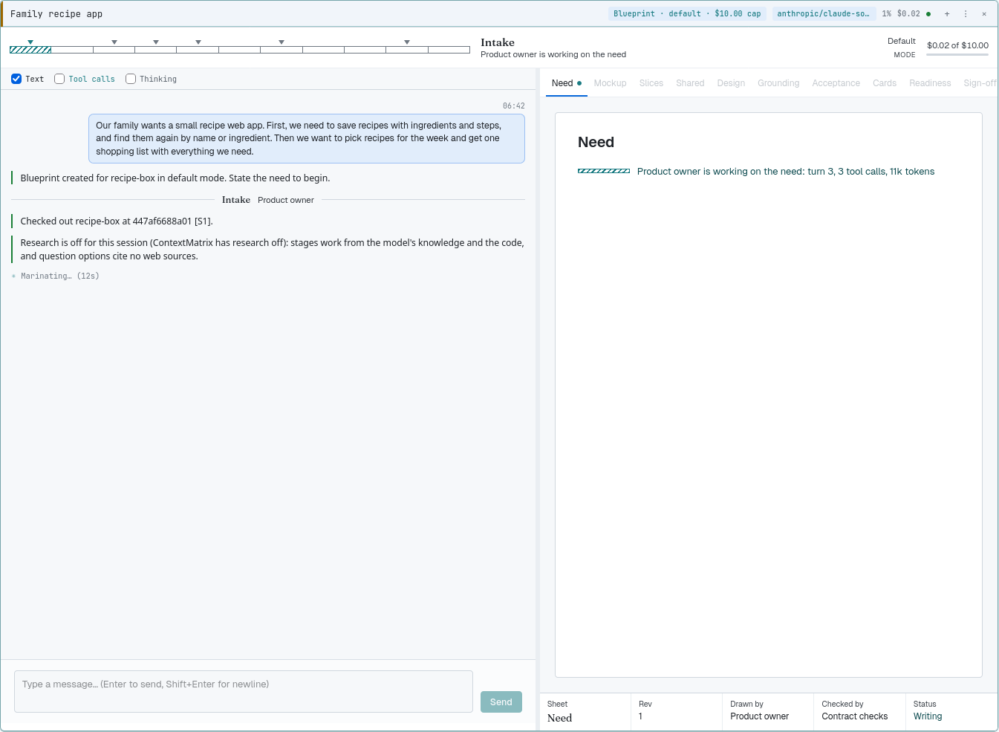

The blueprint's pane has three parts: the chat on the left, the sheet on the
right and the scale bar across the top.

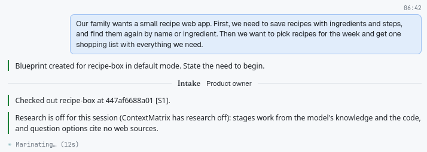

**The chat** is where you and the architect talk. Under the need, **Intake**,
the first **stage** (one step of the architect's work), has started: the product
owner has fetched a copy of the project's code ("Checked out recipe-box") and is
working on the need. The note that research is off means it works from the
model's own knowledge and your code.

**The sheet** shows each stage's result as it is written, laid out like a page
of a technical drawing. Tabs across the top name each sheet, and a dot marks the
current stage's tab. The title block at the foot says which version it is, who
drew it, who checked it and where it stands.

**The scale bar** shows the stages from left to right. The striped segment is
the stage in progress, working or waiting for you, and a small triangle marks a
stage with a gate. Beside the bar a line says what the stage is doing or waiting
for, and at the right end are the mode and the cost so far against the cap
($0.02 of $10.00): click either to change it.

Every mark on the sheet and the scale bar is explained in
[The sheet's marks](reference.md#the-sheets-marks). Most of your replies are
buttons; what each one sends, and the commands you can type, are in
[Replies you can type](reference.md#replies-you-can-type). If a stage fails, or
the cost cap runs out, the chat says what happened and how to go on: see
[When a blueprint stops](reference.md#when-a-blueprint-stops).

## 5. The interview

This step is where the architect asks what it cannot decide on its own.

The product owner came back with a **round**: three questions and eight
**assumptions**, things it decided itself, laid out as tabs. A round waits as
long as you need, and your answers are kept if you leave.

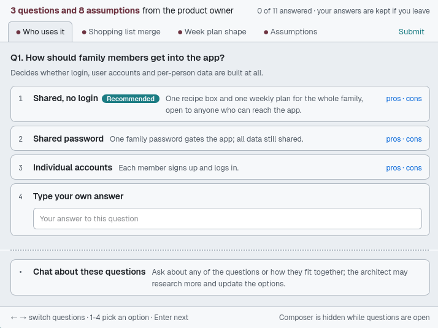

Each question has its own tab. Click an option, or press its number. The one the
architect suggests is marked **Recommended**, and **pros · cons** shows the case
for and against each. If no option fits, write your own under **Type your own
answer**. To ask about the questions first, write in **Chat about these
questions**: the architect answers there and may change the options. While a
round is open, the usual message box is hidden.

For who uses the app the family picked **Shared, no login**, and for the
shopping list they chose to add up matching items. For the week plan no option
fitted, so they typed their own: "Just a list of the recipes we picked for this
week. We do not plan by day."

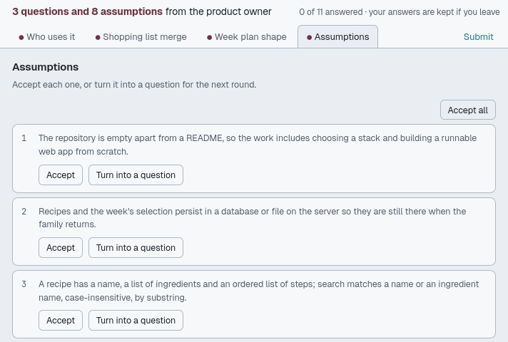

The **Assumptions** tab lets you check what the architect decided itself.
**Accept** one you agree with, or **Turn into a question** to have it asked in
the next round; **Accept all** accepts every one. The family accepted all but
one. Assumption 7 said the shopping list is only shown on screen, with nothing
to tick off; they shop with the list on a phone, so they turned it into a
question.

The last tab, **Submit**, lists your answers. **Submit all** sends them, and
**Send ... now, answer the rest later** stores those you have so far. See
[In a question round](reference.md#in-a-question-round).

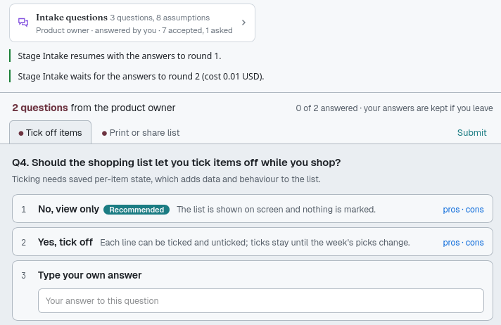

The answered round folds into a summary ("answered by you · 7 accepted, 1
asked"), and the turned assumption came back as a second round: should the list
let you tick items off (Q4), and should it be printed or shared (Q5). The family
chose **Yes, tick off** over the recommended view-only option, and kept the list
on screen only. Questions are numbered across the whole blueprint, so later
steps can point back at each answer.

> [!NOTE]
> **In an auto mode** (Auto, Auto + emit or Yolo) you answer no rounds. An
> **AI responder**, a separate AI run, answers each question in your place and
> accepts the assumptions; the round shows in the chat, read-only. Its answers
> are listed as assumptions at the sign-off. Each gate is decided by the stage's
> reviewer, an AI run that checks the result (more below), instead of you. Auto
> stops at the sign-off; Auto + emit also puts the cards on the board when
> nothing needs a person; Yolo then starts the agent on them too. A gate whose
> result still fails its third review waits for you in every mode. See
> [Modes](reference.md#modes).

### The need, written down

With every answer in, the product owner wrote the **Need** sheet: the problem,
its value, what is in and out of scope, and outcomes that can be measured. Most
lines end with where they came from: [Q1] is the answer to question 1, and
[round1.A3] the third assumption accepted in round 1.

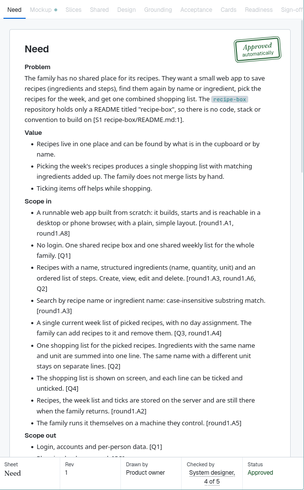

A **reviewer**, a separate AI run that reads the result as the next role would
(here the system designer), scored it 4 of 5 and listed four **findings**,
problems it saw, all minor. A version passes at 4 or more with no critical
finding open. In Default mode Intake's gate is automatic: the reviewer's pass
approves it, so the sheet is stamped **Approved automatically** and nothing
waits for you. See [Gate policies](reference.md#gate-policies) for which gates
wait for you.

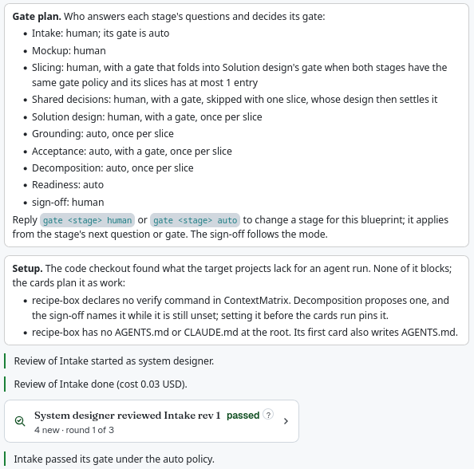

Two notes came with it. The **gate plan** lists each stage with who answers its
questions and who decides its gate: `human` is you, `auto` the AI. Reply
`gate <stage> human` or `gate <stage> auto` to change one for this blueprint;
see [Gate policies](reference.md#gate-policies). The family kept it as it was.

The **Setup** note lists what the project lacks for the agent to work in it. A
new project like recipe-box has no **verify command** yet, the command (such as
running the tests) that checks the agent's work, and no **instruction file**, a
file in the project that tells the agent how it is laid out and how to work on
it. Neither blocks anything: the first card writes the instruction file, and
the architect proposes a verify command, which the sign-off asks you to set in
ContextMatrix before the cards run.

## 6. Trying the screen

This step lets you try the screen before the rest is designed.

The recipe app has a screen people will use, so the architect offered a
**mockup**, a working sketch of the screen you can click through:

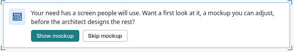

The family clicked **Show mockup**; **Skip mockup** goes on without one. See
[The mockup](reference.md#the-mockup).

> [!NOTE]
> **A need with no screen**, such as a command that only prints its results, a
> service or a job that runs by itself, has no mockup step: nothing is offered,
> nothing is asked, and the blueprint goes on to slicing.

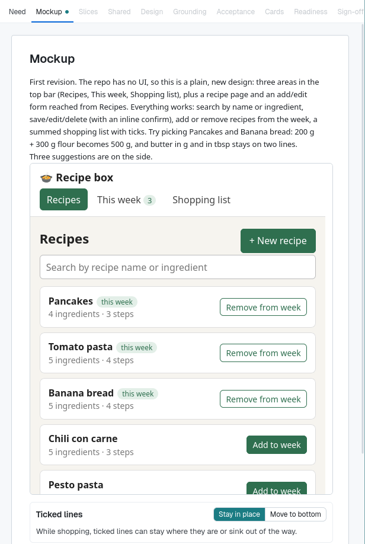

The **designer**, the AI role that draws mockups, showed revision 1 on the
Mockup sheet: a recipe list with search, a This week tab and a Shopping list
tab, all working, with sample recipes to try. Its notes say what to try. For a
project that already has screens, the mockup shows them with the change in
place, in their own look, unless the need asks for a new look.

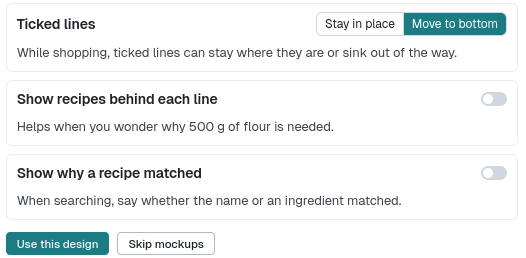

Under it are the designer's **suggestions**, choices you flip to see the mockup
change at once. Flipping costs nothing. The family moved ticked lines to the
bottom of the shopping list and left the other two off.

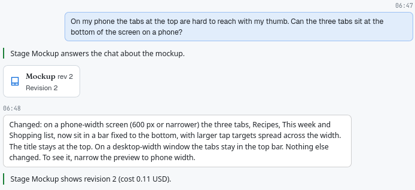

For a change no switch offers, ask in the chat. The family wrote: "On my phone
the tabs at the top are hard to reach with my thumb. Can the three tabs sit at
the bottom of the screen on a phone?" The switches you have flipped go along with
your message, so the next revision starts from them wherever it still offers the
same suggestions. The designer answered with revision 2. Each new revision is
one AI run, paid from the cap ($0.11 here).

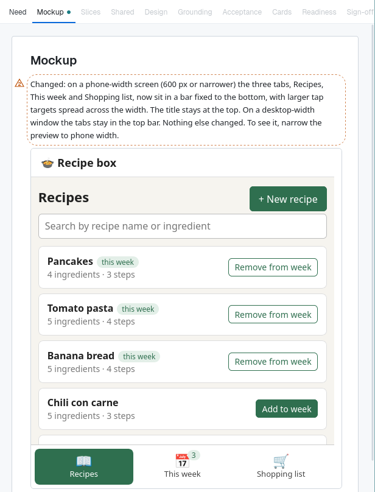

Revision 2 puts the tabs in a bar at the foot of a phone-sized screen. The part
that changed sits inside a dashed **revision cloud**, with the revision number
in the small triangle beside it. Earlier revisions stay: the **Rev** list in the
title block opens them, and **Compare** shows what changed (chapter 9).

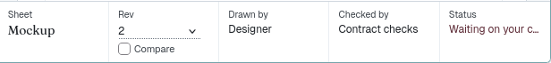

When it looks right, click **Use this design**. Your settings are recorded as
your answers, and the chat confirms: "You chose revision 2 of the mockup; the
architect designs the rest from it." The cards that build these screens will
carry the mockup with your settings. **Skip mockups** goes on without one.

In an [auto mode](reference.md#modes) there is no offer: the AI responder tries
the suggestions and asks for up to five changes while you watch.

## 7. Cutting the work into slices

This step cuts a big need into **slices**, pieces that each work on their own,
built one after another.

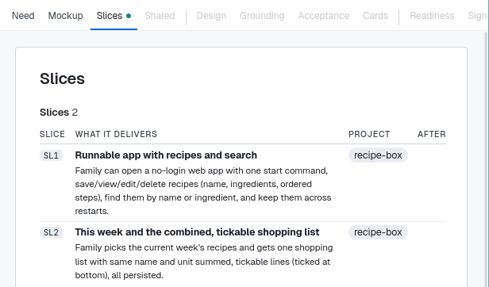

The product owner put the recipes first, as the base the rest builds on. **SL1**,
"Runnable app with recipes and search", is the app itself, with recipes to save
and find. **SL2**, "This week and the combined, tickable shopping list",
completes the need. After SL1 alone the family already has a searchable recipe
box.

The scale bar now groups the stages that run once per slice under SL1 and SL2:
each slice gets its own design, its own check against the code, its own
definition of done and its own cards.

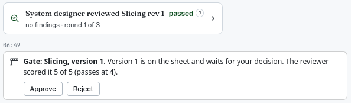

This is the first gate that waits for you. The reviewer, the system designer
again, scored the slicing 5 of 5 with no findings. **Approve** accepts the
version on the sheet, and the work goes on. **Reject** opens a box for what to
change: the slicing is done again with your feedback, and the new version is
reviewed again. The same buttons sit in a bar at the foot of the sheet. The
family approved. See [At a gate](reference.md#at-a-gate).

In an [auto mode](reference.md#modes) the reviewer decides this gate for you,
and a version that passes goes straight on.

> [!NOTE]
> **A need with one slice** skips the next chapter's shared decisions, and its
> Slicing gate does not stop on its own: it folds into the slice's design gate,
> where one **Approve** approves both and **Reject slicing** sends the slicing
> back. That holds while both gates have the same policy, as they do unless you
> change one with a `gate` reply. See [Gate policies](reference.md#gate-policies).

## 8. What every slice shares

This step settles the decisions every slice builds on, such as the programming
language and where the data is kept.

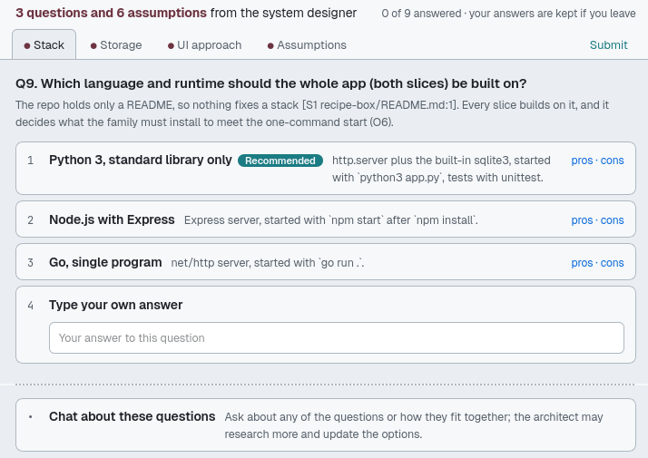

With two slices, the system designer, the AI role that designs how the parts
fit together, asked what both share: the **stack** (the language and tools the
app is built with), the storage, and how the page works. These questions are
technical. If you cannot judge them, the recommended option and its pros and
cons are the architect's advice. With [plain language](reference.md#plain-language)
you would not be asked them: the architect decides, and shows you what each
decision means for you, to accept or turn down.

The family took every recommendation (Python with nothing extra to install, the
data in a single database file, and one web page served by the app) and
accepted all six assumptions.

The **Shared** sheet lists each decision as DEC1, DEC2 and so on: what was
**Chosen**, what was **Rejected** and why, and its **Basis**, the answer it rests
on (Q9 is question 9, round4.A2 the second assumption accepted in round 4). The
numbers jump past the interview's Q5 and round 2 because the mockup counted as
round 3, and its three settings were recorded as questions 6 to 8.

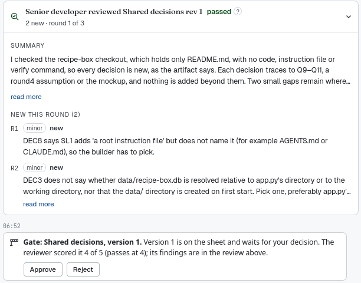

This time the reviewer was the senior developer, the AI role that later writes
the cards. It scored the version 4 of 5 with two minor findings. Click the review
card to read its summary and findings, each with an id (R1, R2), how serious it
is (minor, major or critical) and whether it is new this round; **Findings (2)**
on the sheet's gate bar lists them too. Minor findings do not send a version
back: it comes to the gate with them, and you decide. The family approved.

> [!NOTE]
> **With one slice** this step is skipped: the slice's own design settles these
> decisions too.

## 9. Designing each slice

This step designs one slice in detail: how its parts work and fit together.

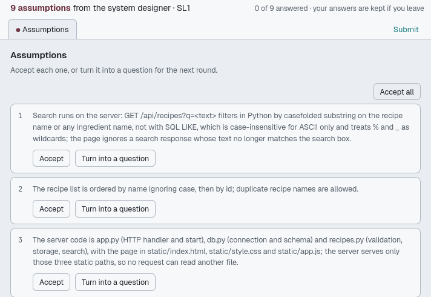

Solution design runs once per slice, SL1 first. For SL1 the system designer
asked no questions, only listed nine assumptions to check, so the round had just
the Assumptions tab. The family accepted all nine.

### When a reviewer sends a version back

The senior developer reviewed version 1 and **sent it back** with four new
findings, one of them major: the page had to drop blank ingredient rows before
saving. A version goes back when it scores below 4 or leaves a critical or major
finding open, and you need do nothing: the system designer wrote version 2,
"Revised for the 4 findings", and the reviewer checked it. Version 2 **passed**:
4 fixed, 1 new, in round 2 of 3. Hover over the **?** beside a verdict for the
rule.

Each version is reviewed once, and at most three versions are reviewed before
the gate. If the third review still does not pass, the gate waits for you,
whatever the mode.

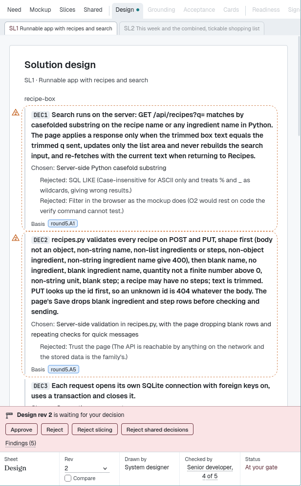

On the sheet, a row of slice tabs picks the slice, and the decisions that
changed in version 2 sit in revision clouds. **Findings (5)** on the gate bar
lists all five findings.

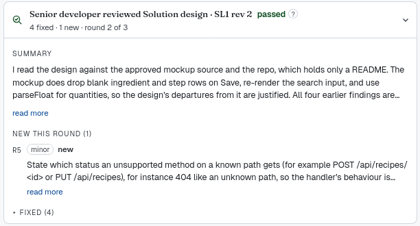

In the chat, open the review card to read the reviewer's summary, the finding
that is new this round, and, folded under **Fixed (4)**, the four findings
version 2 fixed.

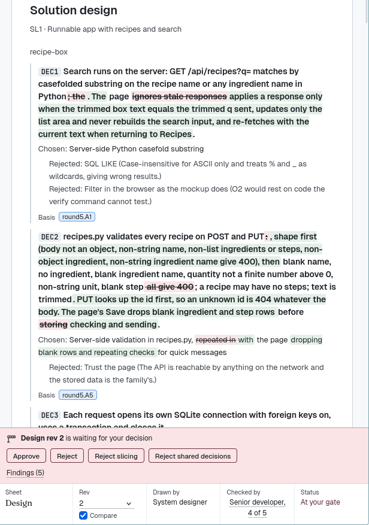

Tick **Compare** in the title block to read version 2 against version 1: removed
text is struck through on red, and added text sits on green.

With two or more slices, a slice's design gate has two more buttons.
**Reject slicing** sends the slicing back with your feedback, and everything
after it runs again. **Reject shared decisions** sends the shared decisions
back, and every slice is designed again. **Reject** runs this slice's design
again with your feedback. See [At a gate](reference.md#at-a-gate). The family
approved version 2.

### The next slice

Before SL2's design starts, SL1 goes through the rest of its stages: the
architect checks its design against the code, writes what done means and writes
its cards. In Default mode the AI responder answers their questions, and
Acceptance's reviewer decides its gate; the other two have no gate (see
[Gate policies](reference.md#gate-policies)). So in the example they ran without
stopping. Then SL2 gets its own design:

SL2's design listed twelve assumptions and no questions, and the family accepted
them. The reviewer passed version 1 at 4 of 5 with two minor findings, and the
family approved it. By then the blueprint had spent $2.39 of its $10 cap.

## 10. Checking against the code

This step checks each slice's design against the project's real code before
any card is written.

**Grounding** runs once per slice, right after its design. The senior developer
reads a copy of the code and checks what the design takes for granted: that the
files and functions it names exist as it says, how the project builds and runs
its tests (its verify command), whether the code has an instruction file,
and which of the blueprint's assumptions the code confirms or contradicts. It
also looks on the board for open cards that already cover part of the need.

Grounding asks you nothing and has no gate, so in the example it ran without
stopping. The **Grounding** sheet's table gives, for each project, the version
of the code it checked, the verify command declared in ContextMatrix and the
instruction file: recipe-box had neither yet. Under **Verified** come the
assumptions the code confirmed, with what was found, here A1: the repository
held only a short description file. A **Contradicted** list appears when the
code says otherwise. Each verdict also sets that assumption's status in the
list the sign-off shows you (chapter 14).

That is what a new project looks like, and the cards set up what is missing
(chapter 12).

## 11. What done means

This step writes down, for each slice, how anyone can tell that it works.

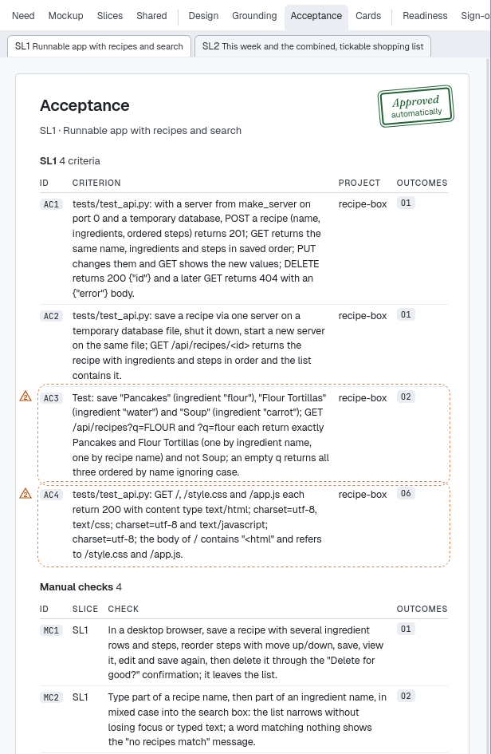

In **Acceptance** the senior developer writes the slice's **acceptance
criteria**: tests or commands the agent runs in the project's code, each naming
its project and the measurable outcomes it proves. SL1 got four. A check only a
person can make, such as trying the real app in a browser, or one that needs a
live system, becomes a **manual check** instead (MC1 to MC4 here). The playbook
will stop at each one until a person has tried it and ticked it off
(chapter 15).

Then comes the **edge-case sweep**. The architect keeps a list of the unusual
cases software tends to meet: empty or missing input, a failure part way
through, who is allowed to do what, two people at once, an old part meeting a
new one, and limits such as the largest upload. For each case the slice names
the criterion or manual check that covers it, or says in a sentence why it needs
none, and the sheet lists the result under **Edge cases**. A slice whose
projects are all proofs of concept skips the sweep, since a POC's cards ask for
the main behaviour and not for hardening. recipe-box is a POC, so neither slice had one. See
[POC projects](reference.md#poc-projects).

The **tester**, the AI role that reads the criteria as someone who must write
the tests from them, reviews each version. In Default mode Acceptance's gate is
automatic: a version the tester passes is approved and stamped **Approved
automatically**, and nothing waits for you. For SL2 the tester sent version 1
back with six findings; version 2, "Revised for the 6 findings", passed with
all six fixed. On SL1's sheet above, the clouds around AC3 and AC4 mark what
changed in its version 2. If the third review still does not pass, the gate
waits for you; see [Gate policies](reference.md#gate-policies) and
[When a blueprint stops](reference.md#when-a-blueprint-stops).

## 12. Writing the cards

This step turns each slice's design and criteria into cards the agent can
build.

In **Decomposition** the senior developer writes the slice's cards: as few as it
can, each one piece of work the agent can finish in one go. Every card has the
same parts: **Context** (why it exists), **Where** (the files and functions it
changes, and the files it creates), **Solution** (the decided approach),
numbered **Acceptance criteria** (each criterion of the slice sits on exactly
one card), **Tests expected** and **Out of scope**. Each manual check gets an
id (M1, M2 and so on) and a place in the run order among the cards, as in
chapter 1's picture.

The Cards sheet opens with a summary. The project lacked two things the agent
needs, and the cards supply them. recipe-box had no instruction file, so D1
also writes one (AGENTS.md), and every other card comes after it. It had no
verify command either, so the architect proposed one, `python3 -m unittest`,
and every card runs it among its criteria. The sign-off asks you to set it in
ContextMatrix (chapter 14).

Each card is listed with its project, kind and priority, how many places in the
code it touches, how many criteria it carries and the card it comes after;
**Card body** opens the full text.

Each time the senior developer hands in the cards, the architect checks them
against its own rules for cards, the **contract checks** ("Checked by Contract
checks" in the title block). Every part is there. Every file named under Where
exists in the code, and every file marked new does not yet. Each criterion sits
on exactly one card, and each manual check has its place in the run order. No
card points at text it does not carry, and no wording would make the agent take
a new feature for a bug fix. A draft that breaks a rule goes back with the list
of problems. If the cards still fail after three tries, the blueprint ends; see
[When a blueprint stops](reference.md#when-a-blueprint-stops).

Cards that build a screen of the mockup you chose carry that mockup: when the
cards go on the board, every card of such a slice gets it, with your settings,
so the agent builds what you tried. Here D2 builds SL1's screens from it.

## 13. Readiness

This step checks every card once more, all slices together, before you see the
plan.

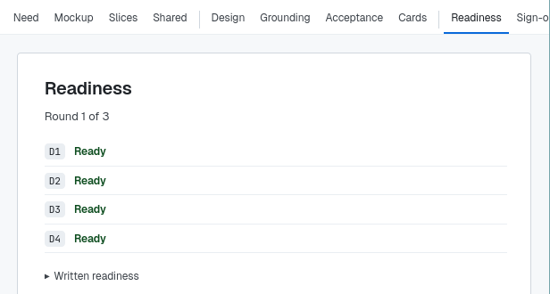

**Readiness** comes after the last slice's cards are written. Its reviewer
reads each card with the code open and asks: could an agent with only this
project's code and this card finish it on the first try? It also checks that
each card is one piece of work, leaves no decision open, adds nothing the plan
does not ask for and does not repeat an open card on the board. Then it looks
across the whole plan for parts that disagree, such as a decision and a card
that say different things, or an outcome no criterion proves. For a POC project
it judges the cards on how clear and buildable they are, not on extra guards.

A card that is not ready goes back to Decomposition with the reviewer's
findings: its slice's cards are written again, and so are the cards of every
later slice, which build on them. Then Readiness checks again, up to three
rounds. A card still not ready after the third round goes to the sign-off with
its findings, and approving then takes a reason (the button reads **Approve over
open findings**); a critical problem across the plan does the same (**Approve
over critical findings**).

In the example every card was ready in round 1. Readiness asks you nothing and
has no gate. If one of the architect's AI runs fails, or the cost cap runs out
on the way, see [When a blueprint stops](reference.md#when-a-blueprint-stops).

## 14. Sign-off

This step is your last word before the cards go on the board.

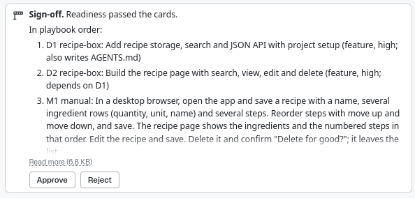

In Default mode the **sign-off** waits for you. Its message says what Readiness
found ("Readiness passed the cards.") and lists the cards and manual checks in
run order. **Read more** opens the rest: the playbook's title, the assumptions
the plan rests on, riskiest first, and the result of the **preflight**, a last
check that every card's project exists in ContextMatrix with a code repository.

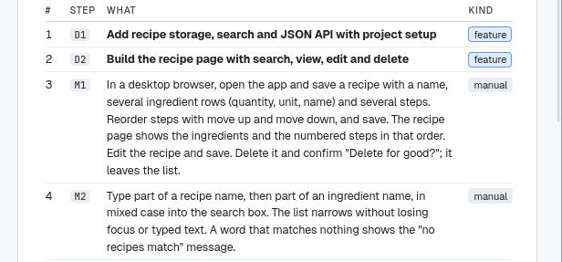

The **Sign-off** sheet shows the same. **Run order** lists the ten steps of the
playbook "Recipe box": the four cards (feature) and the six manual checks
(manual), in the order they run. Below it come the 20 assumptions, each with its
status, such as confirmed by you or verified. The sign-off also listed one
manual step for the family before the cards run: set the verify command
`python3 -m unittest` on recipe-box in ContextMatrix. Nothing blocked and
nothing warned, so the button reads plain **Approve**.

- **Approve** puts the cards on the board (next chapter).
- **Reject** opens a box for what to change. The blueprint then runs again from
  its first decisions, here the shared decisions, with your feedback, and
  everything after them is done again, up to a new sign-off.
- The other rejections are typed only, and the sign-off's text lists the ones
  that apply. `reject slicing <feedback>` runs the slicing and everything after
  it again. `reject shared_decisions <feedback>` runs the shared decisions and
  every slice again. `reject SL1 <feedback>` or `reject SL2 <feedback>` runs
  that slice's design and everything after it again, and earlier slices stay
  as they are: after `reject SL2`, SL1 is kept.

See [At the sign-off](reference.md#at-the-sign-off). The family approved.

In Auto mode the sign-off waits for you too: it is your only stop. Auto + emit
and Yolo approve it themselves when nothing needs a person; see
[Modes](reference.md#modes).

## 15. Cards on the board

This step puts the cards in ContextMatrix and follows the agent while it builds
them.

### Emission

After **Approve**, the architect **emits** the plan: it creates each card on the
recipe-box board, D1 as RECIPEBO-001 and so on, then the playbook with its ten
entries. The chat ends with what it made and the manual steps for you before
the cards run. From here on the mode is locked; the cost cap can still change.
If emission stops part way, the cards already made are kept, and `approve`
carries on where it stopped; see
[When a blueprint stops](reference.md#when-a-blueprint-stops).

The sheet's last tab, **Board**, shows the cards on the board, each with the
draft it came from and its state, the setup steps, and the architect's cost:
$3.16 of the $10 cap. The agent's work on the cards is not part of that cost;
ContextMatrix's own limits cover it. See
[The cost cap](reference.md#the-cost-cap).

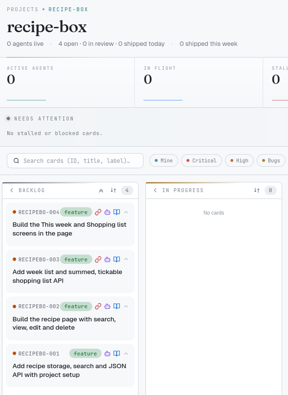

On the recipe-box board the four cards wait in the Backlog column.

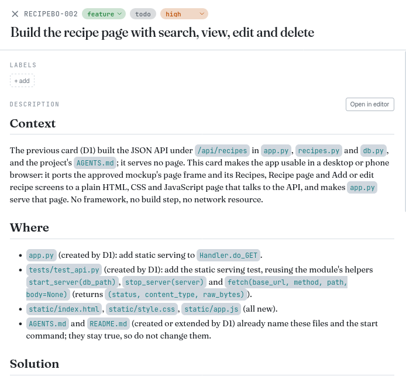

Open a card to read what the agent will get. This is RECIPEBO-002, D2 on the
Cards sheet, with its Context, Where and Solution as the senior developer wrote
them. Further down come its criteria, the tests it expects and what is out of
scope, and after those the mockup the family chose.

### The playbook

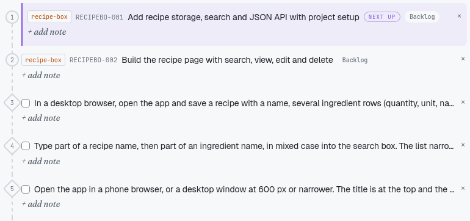

Open the playbook from **Playbooks** in ContextMatrix's sidebar. "Recipe box"
starts with a description, the need's problem and value and every assumption
with its status, and then lists its entries in order: the cards with their
state, and the manual checks, each with a box to tick.

### Before the run

The sign-off's manual step comes first. On the recipe-box board, click
**Settings** at the top right:

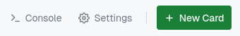

Then open the **Execution** tab:

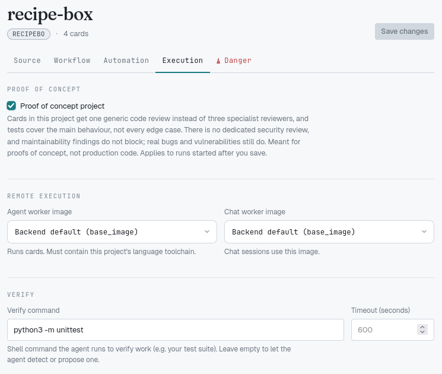

Enter `python3 -m unittest` under **Verify command** and click **Save
changes**. The same tab holds the **Proof of concept project** switch that makes
recipe-box a POC. See ContextMatrix's
[Projects](https://github.com/mhersson/contextmatrix/blob/main/docs/web-ui.md#projects).

### Starting the run

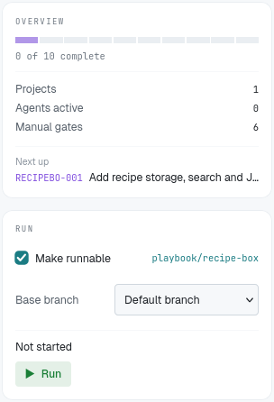

A playbook starts out not runnable. Tick **Make runnable** in its **Run** box:
a dialog lists what that changes. Every card then runs on its own, without
stopping for a person, and each card's work is merged into a branch of the
playbook's own, here playbook/recipe-box: a separate line of the code, kept
apart until the end. Confirm, then click **Run**. See ContextMatrix's
[Make runnable](https://github.com/mhersson/contextmatrix/blob/main/docs/playbooks.md#make-runnable).

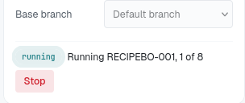

The playbook runs its entries one at a time, from the top. What the agent does
with each card, from planning to merging its work, is described in
ContextMatrix's [agent workflow](https://github.com/mhersson/contextmatrix/blob/main/docs/agent-workflow.md)
and [Playbook runs](https://github.com/mhersson/contextmatrix/blob/main/docs/running-cards.md#playbook-runs).
In Yolo mode the architect starts the run itself, unless a card's repository
has no commits yet; see [Modes](reference.md#modes).

### The watch

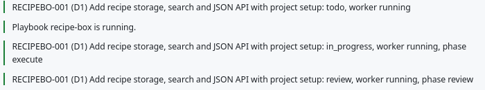

While the session is open, the architect **watches** the cards. It checks the
board every minute by default and posts a line when a card's state, its
**worker** (the agent's run on it) or its **phase** (the step the agent is on)
changes, when a card gets a **pull request** (the agent's proposed change,
waiting to be merged), and when the playbook's run changes.

### When a card's run fails

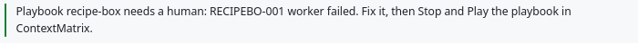

If a card's run fails, the playbook pauses and waits, and the watch tells you
what to do.

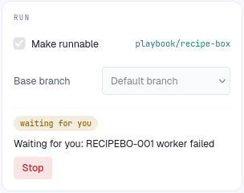

ContextMatrix never tries again on its own. Fix the cause, then click **Stop**
and then **Run** on the playbook page (the line's "Stop and Play"): the run
starts that card again. See ContextMatrix's
[Playbook runs](https://github.com/mhersson/contextmatrix/blob/main/docs/running-cards.md#playbook-runs);
the architect's own stops are in
[When a blueprint stops](reference.md#when-a-blueprint-stops).

### Checks only a person can make

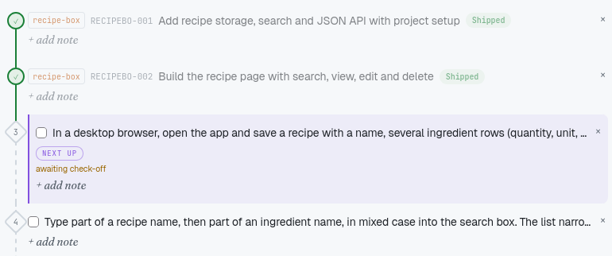

When the run reaches a manual check, it waits: the entry reads "awaiting
check-off", the Run box reads "Waiting for you: awaiting check-off", and the
watch posts "Playbook recipe-box waits for a human to check off:" with the
check's text. Do the check, then tick its box.

After D1 and D2 the family tried the app on their computer. They took a copy
of the code from the playbook's branch and started the app as M4 says:
`python3 app.py`, then `http://localhost:8080/` in a browser.

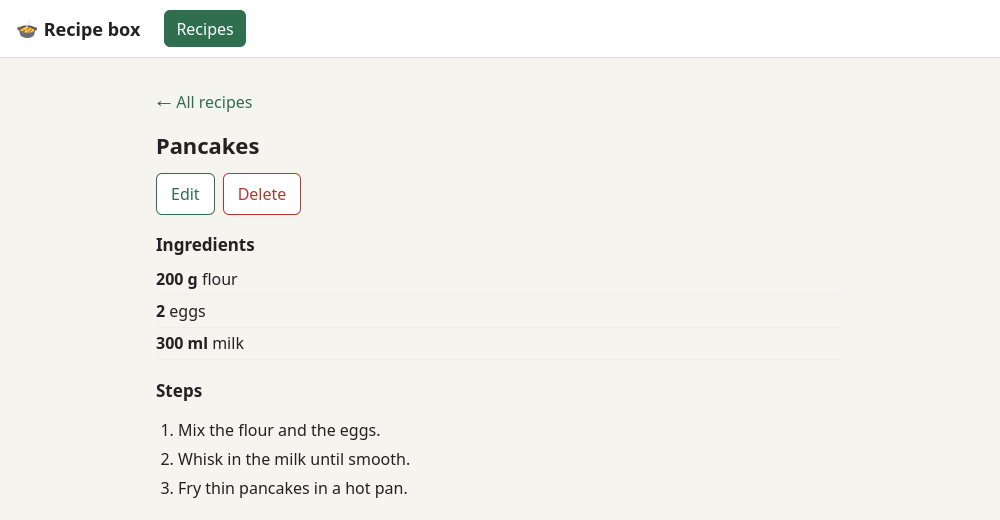

M1: a recipe saved with its ingredients and steps, the steps in the order the
family arranged them.

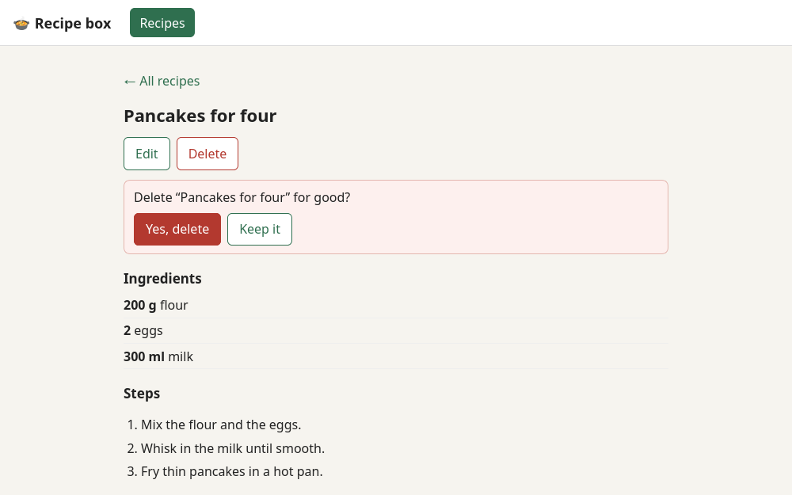

Still M1: after an edit, Delete asks before it removes anything. M2 (finding a
recipe by part of its name or an ingredient, in any mix of capitals), M3 (on a
phone, the Recipes tab sits in a bar at the bottom) and M4 (the app starts with
nothing else to install, and a saved recipe is still there after a restart)
passed too.

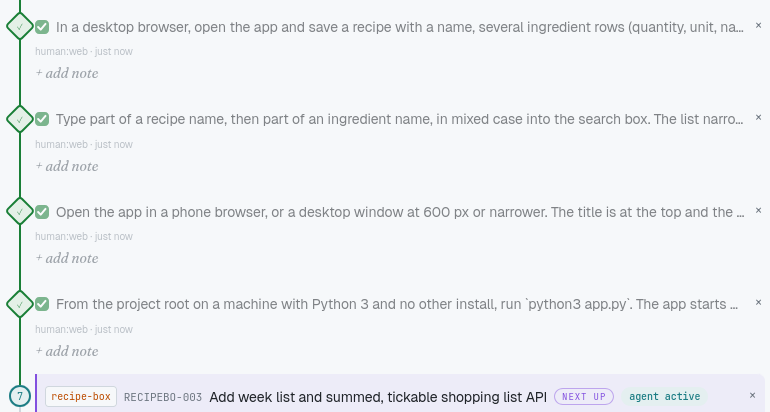

The family ticked M1 to M4, and the run went on by itself to RECIPEBO-003. Each
tick records who ticked it and when. After D3 and D4 the run waited at M5 and
M6, the checks for the week and the shopping list:

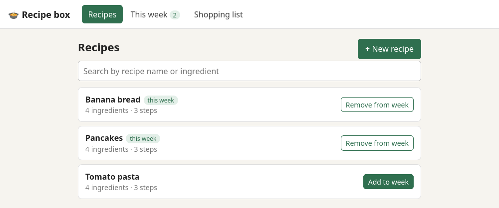

M5: two recipes picked for the week, from the list and from a recipe's page.

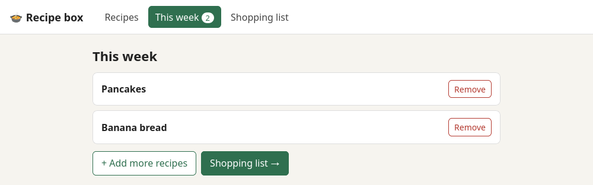

The week is just a list of the picked recipes, as the family asked in the
interview.

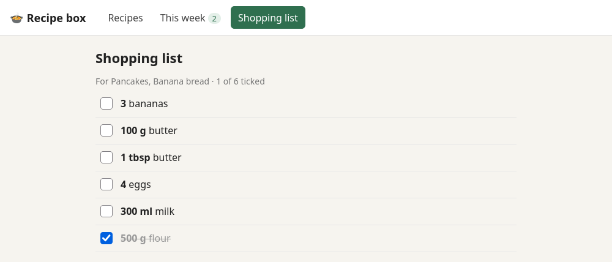

One shopping list for both: the flour of the two recipes is added up on one
line, butter in two different units stays on two lines, and a ticked line moves
to the bottom, as chosen on the mockup. A reload keeps the ticks and the picks.

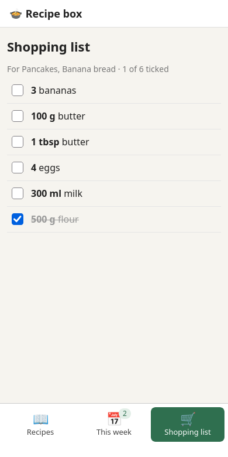

M6: on a phone the three tabs sit in a bar at the bottom, the change the family
asked for on the mockup, and the picks and ticks survive a restart of the app.
The family ticked M5 and M6.

## 16. When it is finished

This step closes the run and keeps the record.

When every entry is done, the run is complete, and the watch ends with a
**closing summary**: each card done with its pull request, the link to the
final pull request for each repository, and the architect's cost ("The
architect's runs cost 3.16 USD.").

The cards' work has been collected on the playbook's branch. The final pull
request brings it into your main code in one go: opening and merging it is up
to you. See ContextMatrix's
[branch model](https://github.com/mhersson/contextmatrix/blob/main/docs/playbooks.md#the-branch-model).

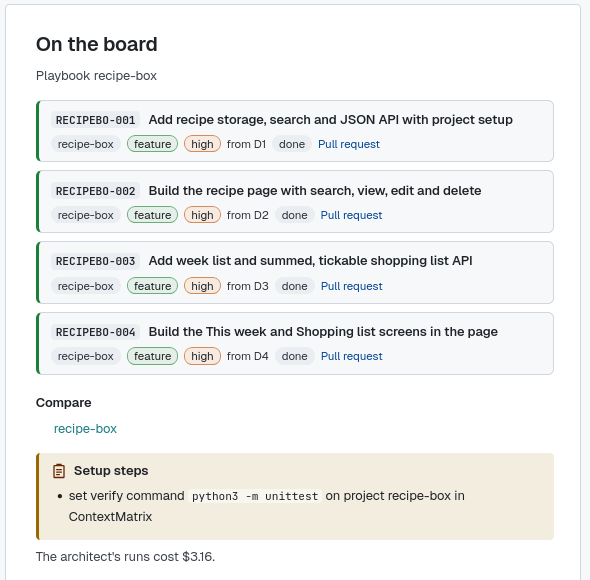

The Board sheet now shows every card done, each with its pull request, and a
**Compare** link for each repository: the same link to its final pull request,
not the Compare box of chapter 9.

The closing summary ends with three ways on:

- `export` writes the blueprint's whole record as text files on the architect's
  server: a summary with every decision, every sheet, the questions and
  answers, the sources, and a log of every AI run. The architect replies with
  where it wrote them, a folder on its server, and how many files (64 here); ask
  whoever runs the architect for them. You can export at any time. See
  [Commands](reference.md#commands).
- `retrospective` looks back at the cards (next chapter).
- **End session**, in the chat pane's menu (the three dots), disconnects the
  chat from the architect; the blueprint is kept, and **Reopen** in the same
  menu starts it again. See
  [Ending and reopening a session](reference.md#ending-and-reopening-a-session).

## 17. Learning from cards that struggled

This step learns from the cards the agent found hard, so that later blueprints
write better ones.

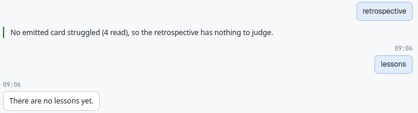

Reply `retrospective` once the cards are on the board, and the architect reads
every card it emitted and how its run went. A card **struggled** when its work
went through two or more review rounds, when it got stuck in ContextMatrix
(stalled, blocked, or **parked**: set aside by the agent for a person) or was
dropped (not planned), or when it cost at least three times what a typical card
did. In the example none did, and `lessons` found none either.

When cards struggle, an AI run paid from the cost cap judges each one and, for
a card at fault, proposes a **lesson** (L1, L2 and so on): a rule for writing
and checking later cards. A **lesson round** then asks about each lesson. It
looks and works like the rounds in chapter 5, with three options: **Approve
for** the card's project, **Approve for the whole pack** (every later
blueprint, whatever its project) or **Reject**. Your own words reword a lesson
and approve it at the scope it proposed. Only blueprints created afterwards get
an approved lesson.

`lessons` lists every lesson, and `retire L<n>`, such as `retire L3`, retires
an active one, so later blueprints no longer get it; see
[Commands](reference.md#commands) and
[In a question round](reference.md#in-a-question-round). The architect also
offers the retrospective when the watch first sees a card parked, stalled or
blocked, and a retrospective that stops runs again on `retrospective`; see
[When a blueprint stops](reference.md#when-a-blueprint-stops).

## 18. Reading the sheet

This chapter gathers the marks of the scale bar and the sheet in one place.
Each one also appears where the example first met it, and
[The sheet's marks](reference.md#the-sheets-marks) lists them all.

### The scale bar

One segment per step, left to right. Filled is done, striped is in progress
(here Slicing, waiting at your gate), an empty outline is not started yet, and a
red outline is a step that failed. A small triangle above a segment marks a
step with a gate. Hover over a segment for its name, role, status and cost, and
click a done one to open its sheet. Beside the bar a line says what the current
step is doing or waiting for.

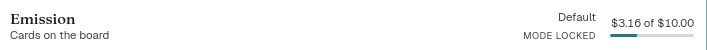

At the right end are the mode and the cost against the cap; click either to
change it. Once the sign-off is approved the mode reads **Mode locked**. The
thin meter under the cost changes colour at 80% of the cap and turns red at the
cap.

### The slice row

With two or more slices, the bar brackets each slice's steps under SL1, SL2 and
so on, with the title of the slice in progress. A sheet that repeats per slice,
such as Design, Acceptance or Cards, gets a row of slice tabs under the sheet's
tabs (chapter 9). With one slice nothing about slices shows.

### The title block

At the foot of every sheet: which sheet it is, the version shown (**Rev**, a
list when there are several, with **Compare** beside it), who drew it, who
checked it and with what score, and where it stands. "Contract checks" means no
AI reviewer reads that sheet, only the architect's own rules (chapter 12).

### Stamps

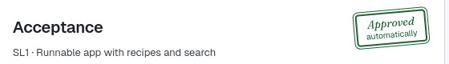

A decided version carries a stamp: **Approved**, by you with the time or
automatically as here; **Rejected**, by you; **Superseded**, by a newer
version; or **Folded**, decided at the design's gate.

### Revision clouds and Compare

On a newer version, each part that changed sits in a dashed cloud, with the
version number in a small triangle in the margin: here AC3 in version 2 of SL1's
criteria. Tick **Compare** in the title block to read a version against the one
before it: removed text is struck through on red, and added text sits on green
(chapter 9).
